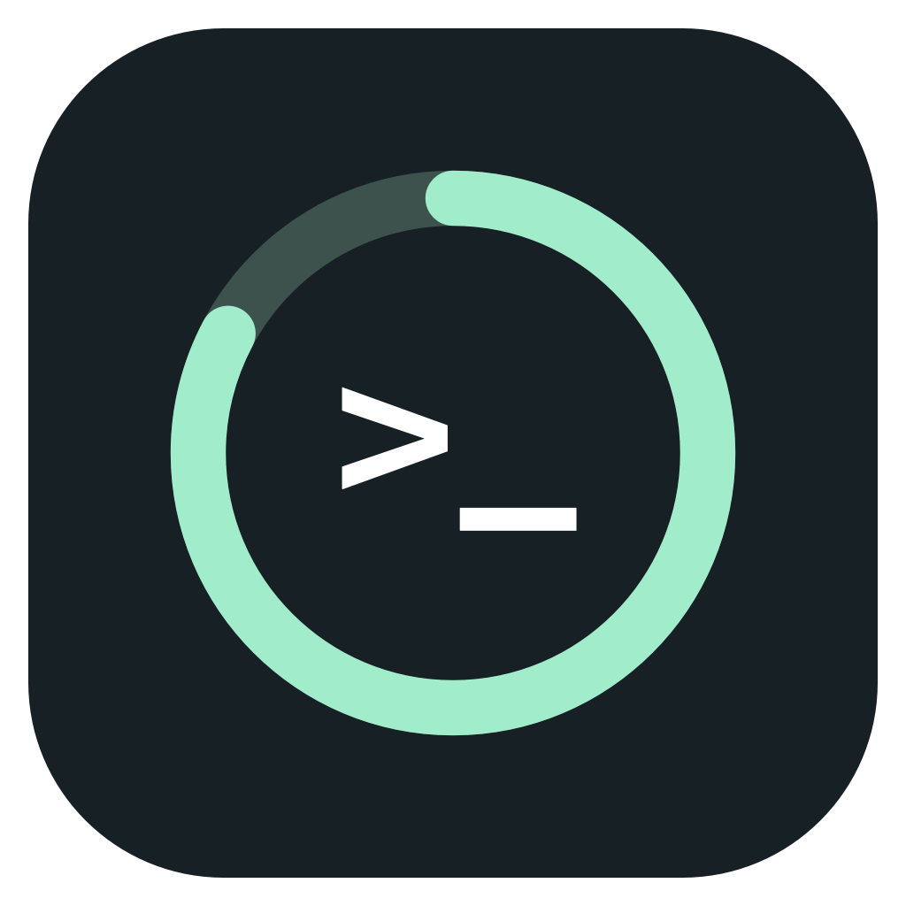
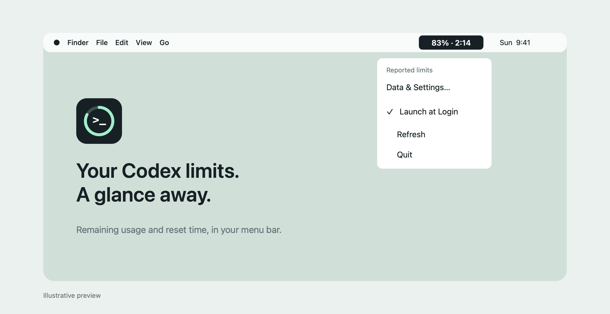
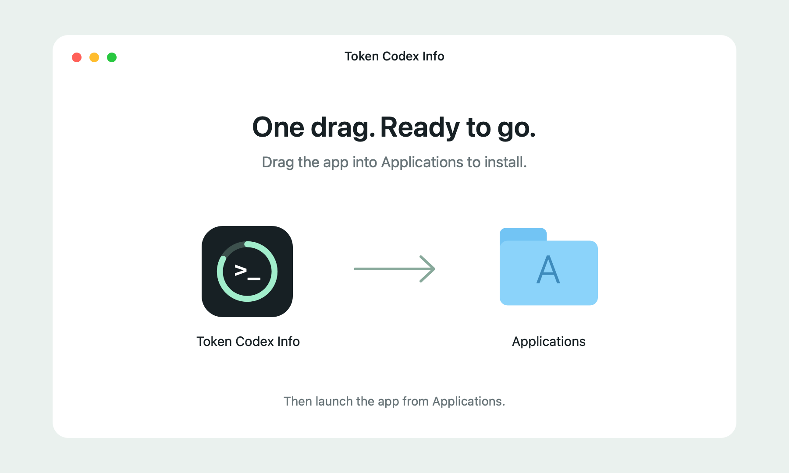

<p align="center">
  
</p>

<h1 align="center">Token Codex Info</h1>

<p align="center">Your Codex limits. A glance away.</p>

<p align="center">
  A lightweight macOS menu bar app that shows your remaining Codex usage and when it resets.<br>
  Keep your limits in sight without breaking your flow.
</p>

<p align="center">
  <a href="../../releases/tag/v1.0.2"><strong>Download 1.0.2 candidate for macOS</strong></a>
  · macOS 14 Sonoma or later · Apple Silicon &amp; Intel
</p>

> [!WARNING]
> Versions 1.0.0 and 1.0.1 can show unreliable token-based estimates (marked ≈).
> Those values must not be interpreted as your account's remaining allowance.
> The 1.0.2 candidate removes these estimates and queries reported account limits.

## App UI



*Illustrative preview. The menu bar shows your actual local Codex usage.*

Features:

- remaining Codex usage as a percentage, right in the menu bar;
- a countdown to the five-hour reset when that window is available;
- automatic weekly allowance and reset-date display when only the weekly window is reported;
- first-launch data and access checks, a folder picker, and Data & Settings in the menu;
- manual Refresh, Launch at Login, and Quit in a compact dropdown;
- native macOS app with no Dock icon or extra window to keep open;
- reported account limits through the installed Codex app server, using your existing Codex sign-in;
- no API key bundled, no token-based quota estimates, and no third-party backend.

## Install

1. Download the universal **DMG** from the [1.0.2 candidate release](../../releases/tag/v1.0.2).
2. Open it and drag **Token Codex Info** into **Applications**.
3. Launch the app from **Applications**. The first-launch window checks your local Codex data.
4. Confirm the detected folder or use **Choose Folder…**, then click **Done**. If no data is available yet, start a Codex session and use **Check Again**.
5. Reopen the checker at any time from **Data & Settings…** in the menu bar.



The DMG includes a custom installation window with the app icon and an Applications shortcut. A ZIP is also available in Releases.

The current build is ad-hoc signed and has not been notarized by Apple. If macOS blocks a build you trust, try opening it, then check **System Settings → Privacy & Security → Open Anyway**. You do not need to disable macOS security protections.

## What the Numbers Mean

| Menu bar | Meaning |
| --- | --- |
| `83% · 2:14` | 83% of the reported five-hour allowance remains; it resets in 2 hours 14 minutes. |
| `88% · 28 Nov` | 88% of the weekly allowance remains; it resets on 28 November. |
| `Codex · Checking` | The app is checking the selected folder. |
| `Codex · Setup` | The selected data folder is missing or is not a folder. |
| `Codex · No limits` | No current reported account limits are available. No percentage is substituted. |
| `Codex · Offline` | Codex could not refresh account limits; check its sign-in and connection. |
| `Codex · No access` | The folder or its usage files could not be read because access was denied. |
| `Codex · Read error` | The usage files could not be read, for example because a database is damaged. |
| `--` after a percentage | Usage is available, but the reset time is not. |

Missing data is never displayed as a full allowance. Expired snapshots do not automatically become `100%`; the app uses a valid reported window or an explicit unavailable state.

The app displays **remaining** usage, converted from Codex's reported `used_percent`. If only a weekly window is available, it shows that window automatically.

## Local Data and Privacy

Token Codex Info first requests `account/rateLimits/read` from the installed
Codex app server. Codex uses its existing sign-in to contact OpenAI. The utility
does not parse or export credentials, bundle an API key, start agent turns, or
send session contents. No third-party backend is involved.

Install the Codex desktop app or CLI and sign in on each Mac. The app finds the
standard desktop, Homebrew, and npm installations automatically. The selected
Codex data folder (usually `~/.codex`) is passed to that local Codex process.

If no Codex executable is available, the utility can display a reported limit
snapshot from local session files or the usage log database. **Data & Settings**
distinguishes **Live limits** from **Reported limits** (a local snapshot). Local
snapshots update only when Codex writes them and may lag behind your account.

If a live request fails, the app reports the failure. If reported limits are
missing, it shows **No limits**. It never calculates account percentages or reset
times from token counts, thread totals, or a guessed plan allowance. Older token
limit settings are ignored. Open Codex, check its sign-in and connection, then use
**Check Again**.

Token Codex Info is an independent utility by [vik1eigh](https://github.com/vik1eigh), not affiliated with or endorsed by OpenAI.

## Build from Source

Requires Xcode 15 or later with Swift 5.9+, plus Python 3.10+ for DMG packaging.

```sh
bash ./script/build_and_run.sh
```

Build the universal app, styled DMG, ZIP, and download page:

```sh
bash ./script/package_dmg.sh
```

The packaging script installs its pinned DMG tooling in `.build/dmg-tools`, generates the shared artwork, and creates the installers in `dist/`. The English download page is in `docs/`; the packaged page in `dist/TokenCodexInfo-download-page.zip` includes working installer downloads and can be served from a static host.

## Test

```sh
swift test
```

## Releases

GitHub Actions tests and packages the app on pushes to `main` and pull requests. Tagging `vX.Y.Z` creates a draft release with the DMG, ZIP, and checksums.

See [development notes](DEVELOPMENT.md) for data sources, parsing behavior, and additional build options.

## Download Page

The English download page includes an app preview, an animated installation
guide, DMG and ZIP downloads, and a short FAQ. To publish it after uploading
the repository, enable **Settings → Pages → Source → GitHub Actions**, then
run **Publish download page** from the Actions tab. The workflow builds and
bundles the actual installers with the page, so its download buttons work
without exposing the private repository's release URLs.

The repository's GitHub plan must support Pages for its selected visibility.
The same `dist/TokenCodexInfo-download-page.zip` can also be hosted on any
static web host. No backend or third-party fonts are required.

## Sponsor this project

If Token Codex Info helps you stay in your flow, you can support its development
on [Buy Me a Coffee](https://buymeacoffee.com/vikleigh).
